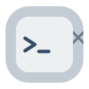

<p align="center">
  <picture>
    <source media="(prefers-color-scheme: dark)" srcset="crates/wired-app/assets/icons/wired-dark.svg">
    
  </picture>
</p>

<h1 align="center">wired</h1>

<p align="center">A fast, lightweight terminal for Windows 11.</p>

<p align="center">
  Built on <a href="https://ghostty.org">Ghostty</a>'s core (libghostty-vt) with a native UI in Rust and Zed's <a href="https://www.gpui.rs">gpui</a>.<br>
  Its tabs, panes and shortcuts follow <a href="https://tabby.sh">Tabby</a>.
</p>

## Features

- **Tabs and panes**: Chromium-style tabs, split panes, multiple windows
- **Built-in glyphs**: pixel-perfect box drawing and blocks in any font
- **Rich looks**: ligatures, translucent and blurred backgrounds, iTerm2 color themes
- **Ready to go**: shells and WSL detected automatically, the beautiful [UDEV Gothic](https://github.com/yuru7/udev-gothic) bundled
- **Solid IME**: inline composition for Japanese and other languages
- **Portable**: one folder, settings included

## Install

Download the zip from [Releases](../../releases), extract it anywhere, and run `wired.exe`.

## Configuration

Settings are in `config\config.toml`. Ctrl+Shift+R reloads them.

For example, wired uses the bundled 3:5 font by default. If you prefer monospace, set:

```diff
 [font]
-family = "UDEV Gothic 35NFLG"
+family = "UDEV Gothic NFLG"
```

## Shortcuts

Edit in `config\keybind.toml`.

| Action | Keys |
|---|---|
| New tab / window | Ctrl+Shift+T / Ctrl+Shift+N |
| Choose a profile | Ctrl+Shift+E |
| Split right / down | Ctrl+Shift+S / Ctrl+Shift+D |
| Close pane | Ctrl+Shift+W |
| Move between panes | Ctrl+Alt+Arrow keys |
| Copy / paste | Ctrl+Shift+C / Ctrl+Shift+V |

Hold Ctrl+Shift to see them on screen.

## Building

Requires Rust (MSVC) and [Zig](https://ziglang.org) 0.17.x.

```
git clone --recurse-submodules https://github.com/twelvehouse/wired-term.git
cd wired-term
cargo run --release -p wired-app
```

Patched dependencies are submodules: [ghostty-wired](https://github.com/twelvehouse/ghostty-wired)
and [gpui-pre-wired](https://github.com/twelvehouse/gpui-pre-wired).

## License

[MIT](LICENSE). Third-party: [THIRD-PARTY-NOTICES.md](THIRD-PARTY-NOTICES.md).

wired is not affiliated with Ghostty, Tabby or Zed.

<sub>The name comes from the wired of <i>serial experiments lain</i>; the X in the icon is her hair clip.</sub>
